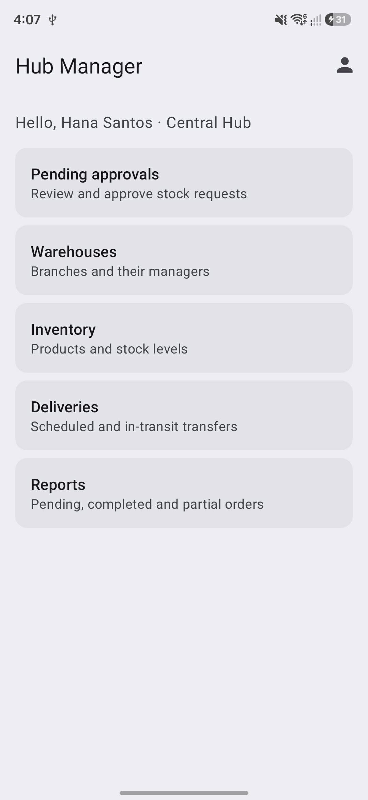
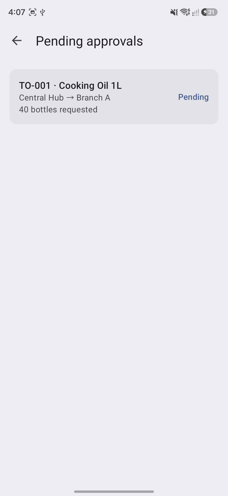
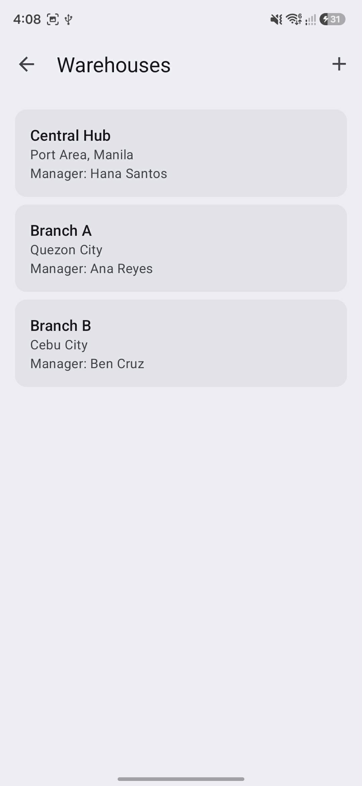
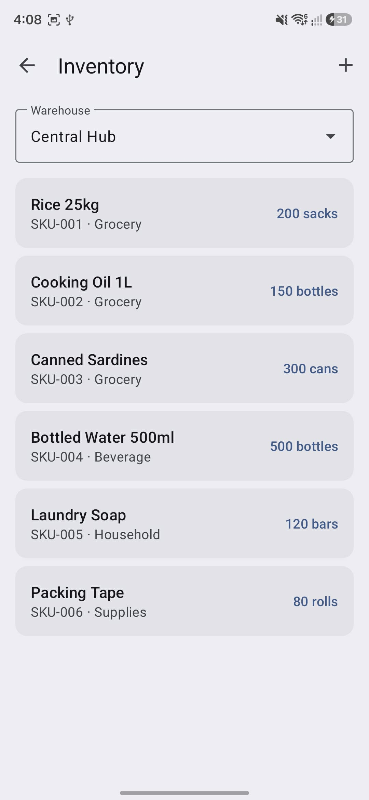
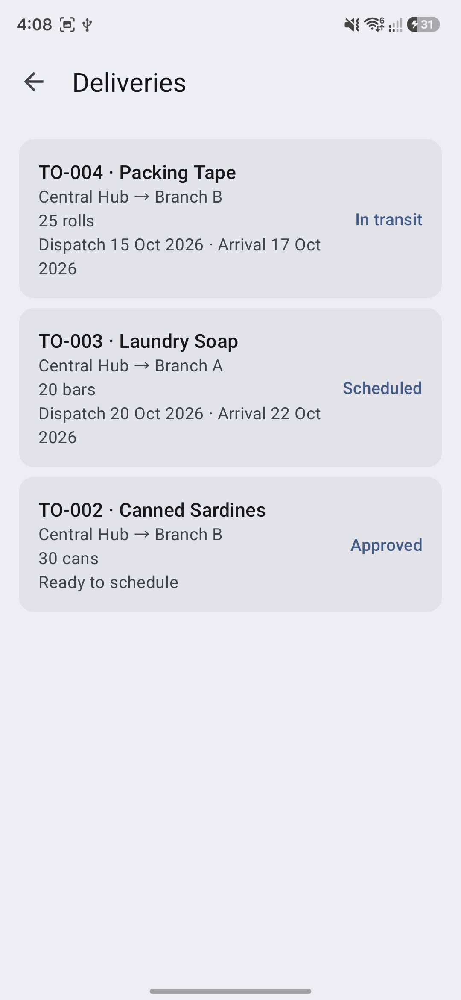
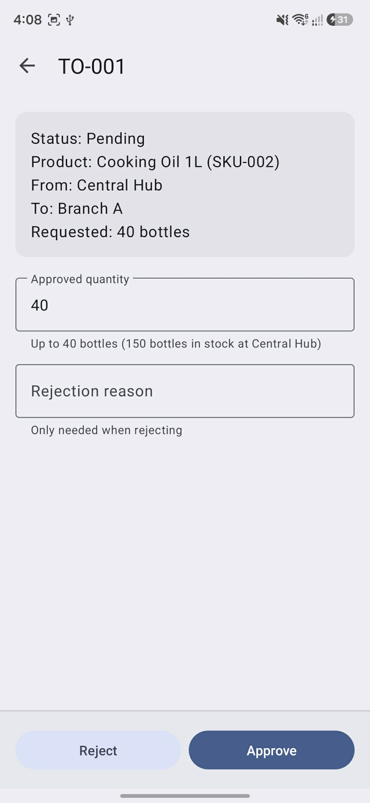

# HubStock

An Android warehouse logistics app for a multi-branch business. Branch managers request stock, the hub manager approves it, deliveries are scheduled and dispatched, and the receiving branch accepts the delivery to update its inventory. It is a fully simulated demo: no backend, no payment gateway and no real notifications.

**Core flow:** Request Stock → Approve → Schedule Delivery → Replenish (Accept Delivery)

## About

HubStock is a practice project built in preparation for the Tagisan ng Talino 2026 - 2027 Code Fest hackathon.

| | |
|---|---|
| Team Name | ERRAnds |
| Team Members | [Vrixzandro Eliponga](https://github.com/mowtiie), [Michael Tagle](https://github.com/ImmunoCapacity), [Christine Jane Lapuz](https://github.com/chrstnjn) |

## Features

**Branch Manager**
- Create a transfer request for their own warehouse: pick the source (default Central Hub), one product and a quantity, validated against the source's available stock
- Track their orders and incoming deliveries
- Accept an in-transit delivery with a received quantity (full receipt completes the order, a shortfall marks it partial and shows the difference)
- View their own stock, with a low-stock warning
- Reports limited to their own branch

**Hub Manager**
- Approve a request with an approved quantity (can be lowered, never above source stock) or reject it with a reason
- Schedule deliveries with dispatch and expected arrival dates, then dispatch them
- Manage warehouses (name, location, branch manager)
- Manage products and Central Hub stock, and view any branch's stock read-only
- Reports for all branches

**Inventory Clerk**
- Manage products and Central Hub stock
- Schedule deliveries and advance their status
- Reports for all branches

**Reports:** Pending, Completed and Partial tabs, each with a count.

## Tech specs

| | |
|---|---|
| Language | Java 11 |
| UI | XML layouts, Material Design 3 (Material Components 1.14), view binding |
| Min / target SDK | 24 (Android 7.0) / 36 |
| Build | Android Gradle Plugin 9.2.1, Gradle 9.4.1 |
| Storage | Local SQLite for user accounts, warehouses, products, stock and orders |
| Theme | Material Theme Builder palette with light and dark mode |
| Navigation | One Activity per screen, no fragments |
| Libraries | AndroidX AppCompat, Material Components and ConstraintLayout only |

## Requirements

- Android Studio (a recent version that supports AGP 9.x) and JDK 11 or newer
- An Android emulator or device running Android 7.0 (API 24) or higher

## Getting started

```bash
git clone https://github.com/mowtiie/HubStock.git
cd HubStock
./gradlew assembleDebug
```

Then open the project in Android Studio and press **Run** on an emulator. The debug APK is created at `app/build/outputs/apk/debug/`.

## Demo accounts

All accounts use the password `demo1234`.

| Role | Email |
|---|---|
| Hub Manager | `hub@demo.com` |
| Inventory Clerk | `clerk@demo.com` |
| Branch Manager (Branch A) | `branch.a@demo.com` |
| Branch Manager (Branch B) | `branch.b@demo.com` |

There is no sign up. The stored account decides which home screen opens. Demo warehouses, products, stock and a few transfer orders in different statuses are seeded on first login, so no screen is empty.

## What is simulated

- Login and logout are fake but validated.
- Transit is simulated by a manual **Dispatch** button. There are no timers, maps or tracking.
- Messages are toasts and snackbars only. There are no real notifications.
- Approving an order does not reserve stock. Stock changes only on dispatch (source) and on accept (destination).
- Each order holds a single product.
- Data is saved in local SQLite and persists across restarts.

## Screenshots

<div align="center">
	<div>
         
         
         
         
         
         
	</div>
</div>

## Verification

APK releases on GitHub are signed using my key. They can
be verified using
[apksigner](https://developer.android.com/studio/command-line/apksigner.html#options-verify):

```
apksigner verify --print-certs --verbose hubstock.apk
```

The output should look like:

```
Verifies
Verified using v1 scheme (JAR signing): false
Verified using v2 scheme (APK Signature Scheme v2): true
Verified using v3 scheme (APK Signature Scheme v3): false
Verified using v3.1 scheme (APK Signature Scheme v3.1): false
Verified using v3.2 scheme (APK Signature Scheme v3.2): false
Verified using v4 scheme (APK Signature Scheme v4): false
```

The certificate fingerprints should correspond to the ones listed below:

```
Owner: CN=Mowtiie
Issuer: CN=Mowtiie
Serial number: 8a256fdcdde50069
Valid from: Wed Jun 10 22:57:23 PST 2026 until: Sun Oct 26 22:57:23 PST 2053
Certificate fingerprints:
         SHA1: 56:4E:2C:DB:E4:06:C9:EC:15:E6:BC:D9:0A:88:38:72:8B:FB:13:20
         SHA256: 8B:67:51:F3:C3:31:85:63:5F:98:95:30:B6:C0:73:A1:39:7B:3D:41:2B:EF:AE:69:06:A2:EB:58:45:D2:DE:63
```

**Warning:** Only install HubStock APKs signed with the key above. Verifying the signature confirms you're running a genuine, unmodified build.

### PGP Signing

As an additional layer on top of the Android signature above, each release is also signed with my PGP key. While `apksigner` confirms the APK itself is intact, a PGP signature confirms that *I* am the one who published this specific file to GitHub — an independent check that doesn't rely on GitHub's account security alone.

**Public key fingerprint:**
```
9EA2 8F46 7802 5092 7643 1B69 42B5 FA42 AA63 90E1
```

Download and import the key from my website, or directly from this repo:

```
curl -O https://mowtiie.cc/PGP_PUBLIC_KEY.asc
gpg --import PGP_PUBLIC_KEY.asc
```

After importing, confirm the fingerprint printed by GPG matches the one listed above — that match is what actually establishes trust, not the import step itself. Fetching the key over HTTPS from a domain you already trust is arguably a stronger anchor than a keyserver, since keyservers accept uploads from anyone and don't vouch for identity.

Each release includes a detached `.asc` signature alongside the APK. Verify a downloaded release with:

```
gpg --verify hubstock-X.X.apk.asc hubstock-X.X.apk
```

A valid signature looks like:

```
Good signature from "Mowtiie <mowtiie.dev@gmail.com>"
```

**Note:** PGP signing is a supplementary trust measure, not a substitute for the `apksigner` check above — verify both if you want the highest confidence that a release is genuine and unmodified.

## License

HubStock is released under the [MIT License](LICENSE).
